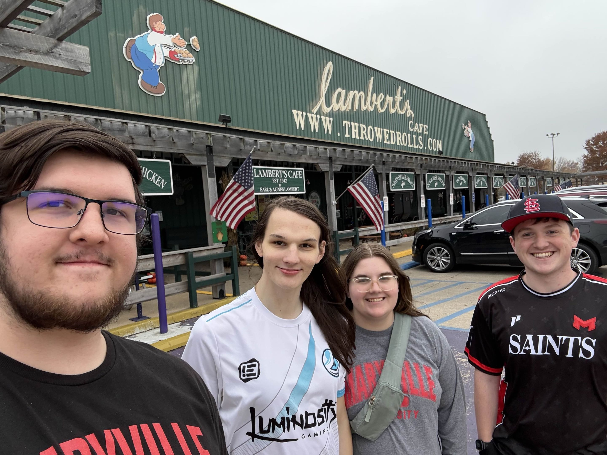

<h1 class="two-col__title">About</h1>

*Team celebration after winning NACE Varsity+ 2025 Fall*

In my childhood, I was often drawn to interesting problems with no clear solution.
That mentality and curiosity stays with me, 10 years later.

Currently I am learning topology, commutative algebra, category theory, and abstract algebra.
All of them are fascinating in their own right. 
The goal is to study algebraic geometry using mathematical logic and category theory.

It's common for me to find already discovered mathematical objects naturally.
For instance, I realized the concepts of homomorphisms could likely be generalized in some way: this is one of the core concepts of category theory! 
While learning about ideals, one of the propositions was that the arbitrary intersection of ideals was an ideal.
This was precisely the same property as closed sets in a topology, so I wondered if these could be made into a topology.
A few months later, the Zariski topology was an exercise in Atiyah-Macdonald, much to my excitement.

I was on a walk with my family when I found the following analogy: if submodules are like subspaces, then prime ideals are like one-dimensional invariant subspaces (eigenvectors). 
In general, the eigenspace does not span the vector space. 
However, *generalized* eigenvectors do, and they decompose any finitely generated vector space.
Is there an analogue of generalized eigenvectors with prime ideals that decomposes the module?
Primary ideals do just that, but the module may not decompose (although the submodules do). This is the *primary decomposition* or *Lasker-Noether* theorem; vector spaces are just a special case.

### Esports

My high school made an esports team my junior year and I joined with open arms. 
I would later join Maryville Esports in 2024 and tryout for a few semi-pro teams, even making one!
Unfortunately, our sponsor backed out and nothing came of it. 
I would make a deal with myself: I would focus heavily on esports during my undergrad and do mathematics for the rest of my life after that period. I graduated in May 2026. It's time for a change in course!

[Notable esports results](https://liquipedia.net/overwatch/Kjersti)

