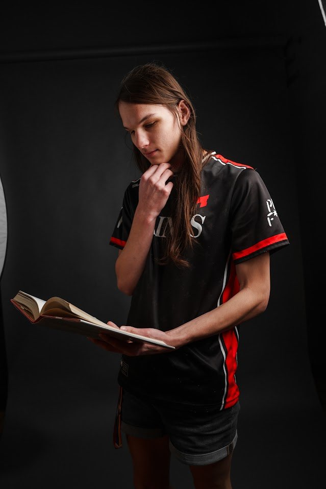

*Maryville Esports*

## Professional Tutor (Mathematics)
*St. Louis Community College · July 2026 – Present*
- Tutored college algebra, precalculus, and statistics through individual and group sessions
- Led study sessions to reinforce course material
- Provided in-class support to students needing additional assistance

## Data Analyst
*Maryville University Esports · January 2024 – May 2025* 
- Served as analyst for the Maryville × Luminosity Gaming partnership during the Spring 2024 collaboration
- Created the [Astryx](https://github.com/KjerstiOW/AstryxFX) project, a custom esports scouting and analytics tool
- Delivered pre-tournament scouting and performance reports in a period where team earnings grew 102% (∼$14K to ∼$28K) while the team quadrupled its A-tier tournament appearances.
- See tournament results on [Liquipedia](https://liquipedia.net/overwatch/Kjersti)

