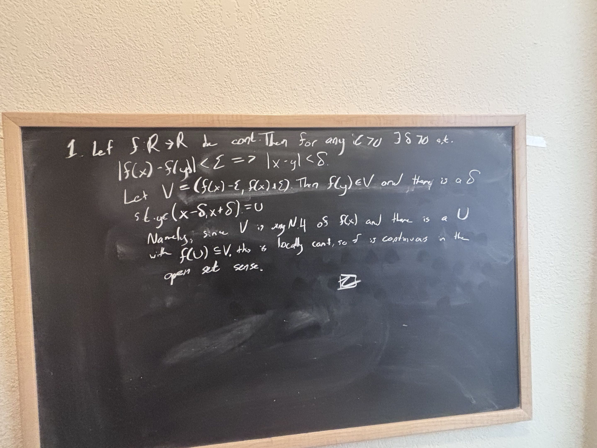

<h1 class="two-col__title">Independent Study</h1>

*δ-Ɛ continuity ⇒ open set continuity*

Anyone interested enough in something will try and learn more about that thing. I am interested in mathematics, so I learn mathematics. 

| Notes | Subject | Book | Status |
| ----- | ------- | ---- | ------ |
| [View](/assets/McMillin_Commutative_Algebra.pdf) | Commutative Algebra | Atiyah-Macdonald | Ongoing |
| | Category Theory | Riehl | Ongoing | 
| | Topology | Munkres | Ongoing |
| [View*](/assets/McMillin_Algebra_Lang.pdf) | Abstract Algebra | Dummit and Foote, Lang | Ongoing |
| | p-adic Numbers | Gouvêa | Paused |
| | Complex Analysis | Conway | Paused |
| | Number Theory | Andrews | Completed |
| [View*](/assets/McMillin_LADR.pdf) | Abstract Linear Algebra | Axler | Completed |
| | Real Analysis | Abbott | Completed |
| [View*](/assets/McMillin_Proofs.pdf) | Proof Writing | Hammack | Completed |
{: .large-table}

*: Partial material

